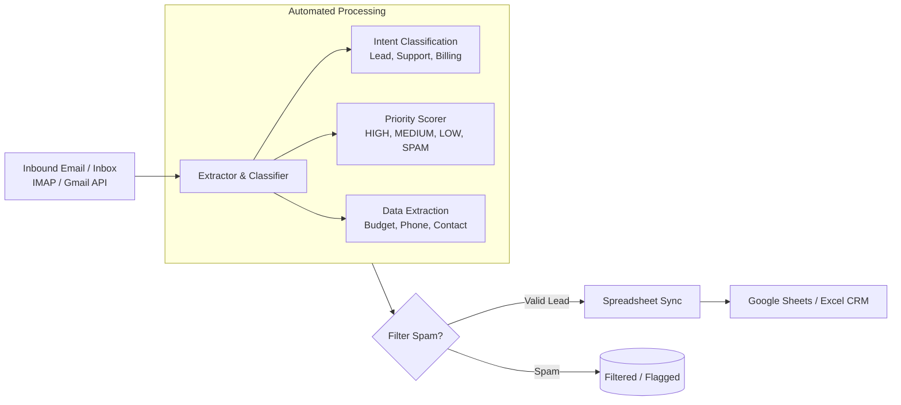

# email-to-sheets-crm

[](https://github.com/elvalenciano1572-create/email-to-sheets-crm/actions/workflows/ci.yml)


An automated ingestion pipeline in Python that extracts client leads, budget estimates, contact info, and support inquiries from emails directly into Google Sheets or Excel.

Never miss a high-priority lead lost in an inbox. Instead of manually copying data between email clients and spreadsheets, **email-to-sheets-crm** classifies messages, scores priority, parses key figures, and syncs them automatically with zero data leakage.

## Architecture



## Features

- **Automated Intent Classification**: Categorizes inquiries into *New Project, Support, Billing, Partnership*, or *General*.
- **Entity Extraction**: Automatically extracts budget figures (`$`, `€`, `£`), phone numbers, and client names using regex and NLP sanitization.
- **Priority Scoring**: Labels urgent emergencies as `HIGH` priority and filters out phishing/spam solicitations.
- **Spreadsheet Sync**: Exports structured lead rows with timestamps directly into CSV / Excel with deduplication.

## Quick Start

```bash
git clone https://github.com/elvalenciano1572-create/email-to-sheets-crm
cd email-to-sheets-crm
python -m venv .venv && source .venv/bin/activate  # Windows: .venv\Scripts\activate
pip install -e ".[dev]"
pytest
email-crm --output leads.csv
```

### Live Gmail -> Google Sheets (optional)

```bash
pip install -e ".[google]"
export GOOGLE_TOKEN_FILE=/path/to/authorized_user_token.json   # never commit this file
email-crm --source gmail --gmail-query "in:inbox newer_than:7d" --max-emails 20 --sheet-id <SHEET_ID>
```

Gmail is read with read-only API calls. Rows are appended to the sheet as raw text (no formula
injection) and message IDs already present are skipped, so re-running is safe.

## Example Output

```text
=================================================================
   EMAIL-TO-SHEETS CRM: INBOX INGESTION & PIPELINE ENGINE
=================================================================
[*] Fetched 3 inbound email messages (sample).
[*] Filtered 1 spam/irrelevant emails.

[Parsed Leads Overview]:
  + [MEDIUM] Sarah Jenkins (sarah.j@acme-corp.com)
    Category: New Project Inquiry | Budget: $3,500
    Phone: +1 555-0199 | Action: Respond with discovery call link
  + [HIGH] David Miller (dmiller@fintech-ventures.io)
    Category: Support / Technical Help | Budget: N/A
    Phone: +44 20 7946 0912 | Action: Review and route

[OK] Successfully synchronized 2 leads to: leads.csv
=================================================================
```

## License

MIT

## Scope / Status

- **Offline Demo Mode:** Runs out-of-the-box on deterministic sample data for fast CLI evaluation and CI testing.
- **Production Mode (Verified Live):** Full end-to-end integration with the Gmail API (read-only search) and Google Sheets API v4 (idempotent row appending with formula injection defense via `RAW` values).
- **IMAP Mode:** Planned for non-Google mail providers.
